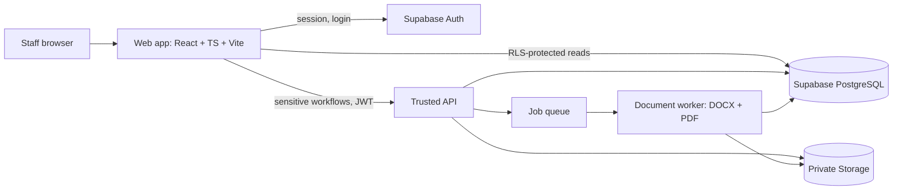
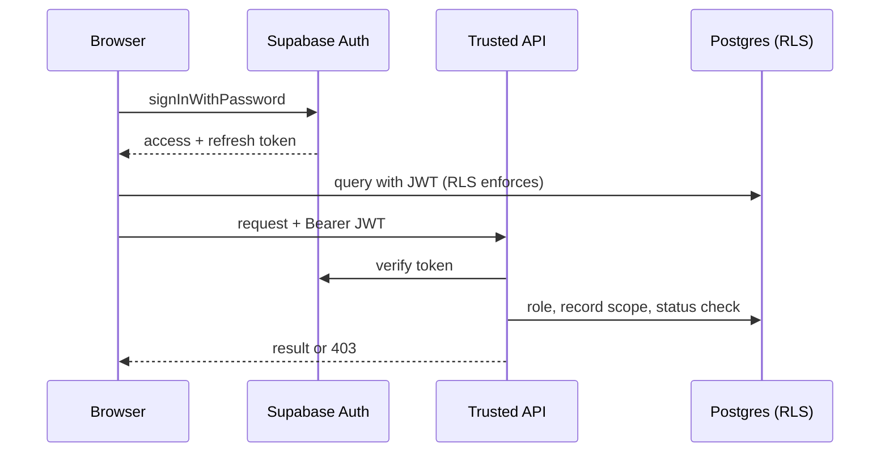

# Architecture — Excel-to-Annex C CAR Management System

Principle: **Supabase is the identity source; the database + trusted server decide permissions.** Audit the existing repo first; do not replace the framework.

## 1. Context Diagram

## 2. Components
| Component | Responsibility | Trust level |
|-----------|---------------|-------------|
| Web app | UI, session handling, client validation (UX only) | Untrusted |
| Supabase Auth | Login, sessions, recovery, verification | Trusted IdP |
| Trusted API | Verify JWT, role + record access + status transition, validation, orchestration | Trusted |
| PostgreSQL | System of record, constraints, RLS, transactions | Trusted |
| Private Storage | Workbooks, templates, generated DOCX/PDF | Trusted, no public URLs |
| Document worker | Render DOCX, convert PDF, verify output | Trusted, isolated |
| Job queue | Durable, retryable, idempotent jobs (DB-backed acceptable) | Trusted |

## 3. Recommended Stack
- **Frontend:** React + TypeScript + Vite (retain the existing framework after auditing the repository)
- **UI styling:** Tailwind CSS
- **Backend platform:** Supabase
- **Authentication:** Supabase Auth
- **Database:** Supabase PostgreSQL
- **Database security:** PostgreSQL Row-Level Security (RLS)
- **File storage:** Supabase Storage with private buckets
- **Server-side functions:** Supabase Edge Functions using TypeScript for privileged workflows, authorization checks, validation, and orchestration where appropriate
- **Excel processing:** SheetJS (`xlsx`), with server-side parsing for committed imports
- **DOCX generation:** Docxtemplater with table-loop support
- **PDF generation:** A controlled, server-side DOCX-to-PDF conversion worker, such as sandboxed LibreOffice
- **Job queue:** PostgreSQL-backed job queue using transactions and `FOR UPDATE SKIP LOCKED`, or a suitable managed queue
- **Charts and dashboards:** Recharts
- **Testing:** TypeScript-aware unit tests, integration tests, RLS and authorization tests, and end-to-end tests
- **Deployment:** Existing frontend hosting, Supabase services, and a separate worker deployment if required for reliable DOCX/PDF generation

**Language standard:** Use TypeScript for frontend code and Supabase Edge Functions. Enable strict type checking where supported. Define shared types for API payloads, database records, import-validation results, CAR states, and document-generation jobs. Validate incoming requests and Excel data at runtime; TypeScript types alone do not validate untrusted input.

**Backend principle:** Use Supabase as the primary backend platform. Do not add a separate Express/Node.js API unless a documented requirement cannot be handled appropriately by Supabase services and functions.

## 4. Auth & Authorization Architecture

- Roles live in `user_roles` (protected; only admin/server writes). Never `isAdmin` in the client.
- Profile `status` (active/disabled) checked on every protected call.
- Service-role key: server-only, never in frontend env/bundle.
- Defense in depth: RLS for direct client reads; API for state transitions (submit, approve, generate, download).

## 5. Key Architecture Decisions (ADRs)
| ID | Decision | Rationale | Trade-off |
|----|----------|-----------|-----------|
| ADR-1 | Hybrid access: RLS for reads, API for workflows | Least privilege + centralized rules for transitions | Two enforcement paths to test |
| ADR-2 | Raw import rows immutable; corrections as overlay records | Traceability, audit | Join complexity |
| ADR-3 | Async doc generation via queue | PDF conversion is slow/failure-prone | Status UX needed |
| ADR-4 | Revisioned CARs; approved = immutable | Provenance, legal defensibility | More rows |
| ADR-5 | Template versions immutable once activated | Reproducible output | New version for any change |
| ADR-6 | Text for HH_ID/ENTRY_ID/LRN/PCN | Preserve leading zeros | Careful comparisons |
| ADR-7 | Signed short-lived URLs, logged | No public exposure | Re-issue on expiry |
| ADR-8 | Parse Excel on server (or worker) for commit; client parse only for preview | Don't trust client data | Upload size limits |
| ADR-9 | Privileged actions admin-only, enforced in API + RLS via `is_admin()`; optional `admin_only` access mode | Least privilege; contain blast radius; maintenance lock | Admin accounts are high-value targets: needs re-auth, audit, last-admin guard |

## 6. Deployment
- Frontend: existing static/SPA hosting.
- API + worker: containerized service(s) with private networking to Supabase; worker sandboxed (no outbound except Supabase), resource-limited, timeouts.
- Environments: dev / staging / prod with separate Supabase projects; migrations in version control.
- Secrets: platform secret manager; rotation documented.

## 7. Cross-Cutting
- **Observability:** structured logs (IDs only, no PII), job metrics, alerts on failure/retry spikes.
- **Backup/DR:** Postgres PITR + storage backups; restore drill before release.
- **Rate limiting:** auth, upload, download endpoints.
- **File safety:** MIME/extension/size checks, macro-free `.docx` validation, virus scan if available, zip-bomb limits.
- **Config:** env vars only; no source literals.

## 8. Phase → Architecture Mapping
| Phase | Architecture delivered |
|-------|-----------------------|
| 1 | Supabase Auth client, profiles, user_roles, RLS baseline, API JWT middleware |
| 2 | Imports pipeline, import_rows, households/members, grantee validator |
| 3 | case_assessments, interventions, state machine, review endpoints |
| 4 | Templates, mapping, queue, worker, generated_reports |
| 5 | Dashboard views/aggregates, audit search |
| 6 | Test/hardening, DR, load, layout tests |