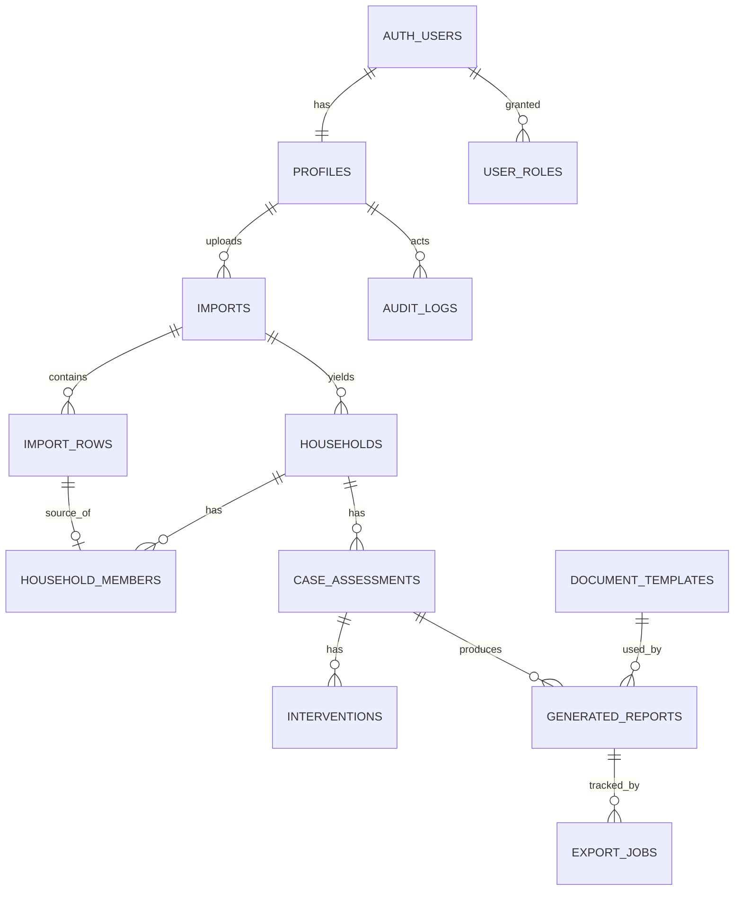
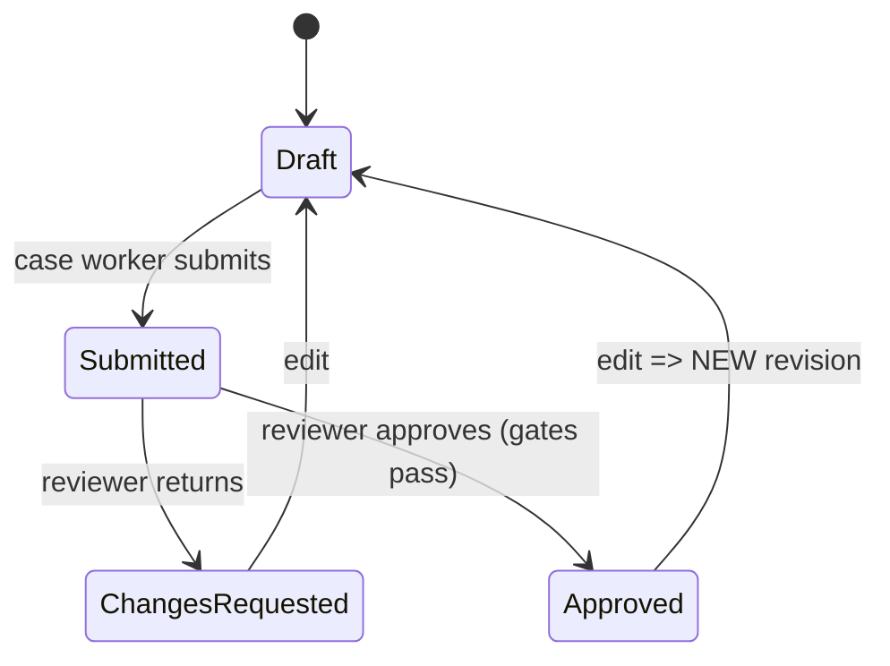

# System Design — Excel-to-Annex C CAR Management System

## 1. Data Model (ERD)

### Tables (key columns)
| Table | Key columns / constraints |
|-------|--------------------------|
| profiles | `id uuid PK = auth.users.id`, display_name, status (active/disabled) |
| user_roles | user_id FK, role enum; unique(user_id, role); write = admin/server only |
| imports | id, file_hash (fingerprint), storage_path, sheet_name, version, status, uploaded_by, column_mapping jsonb; unique(file_hash, sheet_name) for dup detection |
| import_rows | import_id, source_row_no, raw jsonb (immutable), normalized jsonb, errors jsonb, status |
| households | id, import_id, hh_id **text**, grantee_status (valid/none/multiple/invalid/blank), review_status; unique(import_id, hh_id) |
| household_members | household_id, import_row_id FK, entry_id **text**, lrn **text**, pcn **text**, is_grantee_flag raw, excluded bool |
| household_corrections | household_id/member_id, field, old, new, reason, actor, at (overlay; raw untouched) |
| case_assessments | id, household_id, grantee_member_id, status, revision int, owner_id, reviewer_id, content jsonb, missing_fields jsonb; unique(case_group_id, revision) |
| interventions | assessment_id, seq, type, details |
| document_templates | id, name, version, storage_path, field_mappings jsonb, required_fields, repeating_config, status (draft/validated/active/retired) |
| generated_reports | assessment_id, revision, import_id, template_id+version, docx_path, pdf_path, kind (draft/approved), approved_by/at, checksums |
| export_jobs | id, idempotency_key unique, state, attempts, last_error_safe, output_verification jsonb |
| audit_logs | actor, action, entity_type, entity_id, at, before/after (PII-minimized) |
| system_settings | key (pk), value jsonb, updated_by, updated_at; includes `access_mode` (`standard`/`admin_only`), required-field list, retention settings; write = admin via API only |

Indexes: `households(hh_id)`, `case_assessments(status, household_id)`, `export_jobs(state)`, `audit_logs(entity_type, entity_id, at)`.

## 2. State Machines
### Import
`uploaded → mapped → validating → validated | failed → committed`

### Household review
`ok` (exactly one valid GRANTEE=Yes) · `needs_review` (zero / multiple / blank / invalid) → human resolution → `resolved`. **System never auto-selects.**

### CAR

Approval gates: one validated grantee · no blocking conflicts · required fields complete or authorized exception · active approved template. Reviewer ≠ author (recommended; confirm with owner).

### Template
`draft → validated → active → retired` (activation by authorized role; immutable after active).

### Export job
`queued → running → docx_ok → pdf_ok → verified | failed(retry n)`; idempotency key = (assessment_id, revision, template_version, kind).

## 3. Import Pipeline
1. Upload to private storage; compute SHA-256; dup check.
2. Parse server-side; detect header row; user maps columns; preview.
3. Validate: required columns, types, text-preserving IDs, grantee flag domain.
4. Persist `import_rows` (raw immutable) in a transaction.
5. Group by HH_ID → households/members; evaluate grantee rule.
6. Emit validation report (row numbers + guidance) downloadable.
7. Commit creates immutable import version.

Grantee rule: count members where GRANTEE normalizes to Yes. =1 → ok; 0, >1, blank, unrecognized → needs_review. Normalization rules documented and unit-tested.

## 4. Document Generation Pipeline
1. API validates state + permissions, inserts `export_jobs` (idempotent).
2. Worker claims job (`SKIP LOCKED`), loads revision + active template.
3. Docxtemplater renders (repeating table for family composition); draft gets visible DRAFT/missing-field warning.
4. Convert DOCX→PDF; verify both (opens, page count, no unresolved placeholders, checksum).
5. Store in private storage; record `generated_reports`; audit.
6. Failure → safe error, bounded retries with backoff, then `failed`.

## 5. API Contract (proposed)
| Endpoint | Roles | Notes |
|----------|-------|-------|
| POST /imports, GET /imports/:id, POST /imports/:id/commit | operator, admin | status + summary |
| GET /households, GET /households/:id | case worker+, auditor(RO) | scoped |
| POST /households/:id/resolve-grantee | case worker, reviewer | audited, requires reason |
| POST/PATCH /case-assessments, POST /:id/submit | case worker | status-gated |
| POST /case-assessments/:id/decision | reviewer | approve / request changes |
| POST /templates, POST /templates/:id/validate, POST /templates/:id/activate | admin | |
| POST /case-assessments/:id/generate | case worker/reviewer | queues job |
| GET /reports/:id/download | per policy | signed URL, logged |
| GET /audit-logs | auditor, admin | filtered |

Every call: verify JWT → profile active → role → record scope → allowed transition → validate payload → write + audit in one transaction. Errors: 401/403/404 (no existence leak)/409 (state conflict)/422.

## 6. RLS Policy Sketch
- profiles: user reads own; admin reads all.
- user_roles: read own; write admin/server only.
- households/members/CARs: select by role + assignment scope; no client writes to approval/status fields (API only).
- audit_logs: insert via server; select auditor/admin.
- Storage: no public buckets; access via signed URLs issued by API.

### Admin-only rules
- Admin = `user_roles.role = 'admin'` AND `profiles.status = 'active'`, checked server-side per request via `is_admin()` (SECURITY DEFINER, fixed search_path).
- Admin-only: user/role management, template upload/validate/activate/retire, system settings, purge, audit export, re-run others' jobs, switching `access_mode`.
- When `access_mode = admin_only`, API middleware and RLS additionally require admin; others get 403.
- Last-admin protection, no self-escalation, re-auth for critical actions. Full spec: `05-ADMIN-ONLY-RULES.md`.

## 7. Security & Privacy Controls
Least privilege · IDOR tests · PII-free logs · dashboards aggregate-only (no LRN/PCN/pregnancy/disability) · bulk download restricted + logged · retention/deletion policy (owner-defined) · encryption in transit/at rest · rate limits · upload hardening.

## 8. Dashboard Metric Definitions
| Metric | Definition |
|--------|-----------|
| Rows processed | Sum of import_rows for committed imports |
| Households detected | Count households per import version |
| Needs review | households.review_status = needs_review |
| CAR drafts / awaiting / approved | case_assessments by status (latest revision) |
| Export failures | export_jobs.state = failed in period |

## 9. Concurrency & Idempotency
Unique constraints on (assessment, revision) and job idempotency key; optimistic locking via `revision`/`updated_at`; transactional approval; duplicate retries no-op.

## 10. Test Matrix
| Area | Cases |
|------|-------|
| Auth | valid/invalid login, refresh, logout, expired, recovery, disabled, wrong role |
| Authz | URL/API ID tampering, self-role-grant, RLS allow/deny |
| Import | leading zeros, dup file, blank rows, bad headers, large file |
| Grantee | 1 valid / 0 / many / blank / invalid; 5 members + 1 Yes → 1 household, 5 members |
| CAR | draft with missing fields, submit, return, approve, re-edit → new revision |
| Docs | placeholder coverage, repeating rows, DOCX+PDF verify, layout, failure reporting |
| Ops | concurrent jobs, retries, backup restore |
| Privacy | no PII in logs/dashboards |
| Admin-only | non-admin 403 on A1–A9; RLS denies direct writes; no self-grant; last-admin block; disabled admin; admin_only mode on/off |